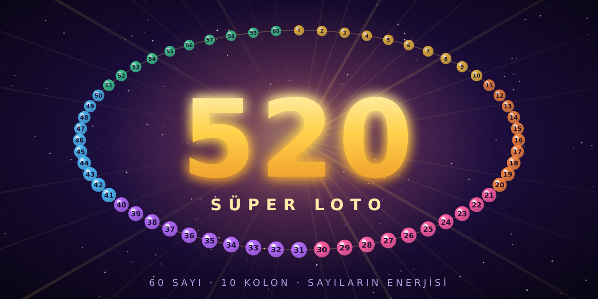

# Süper Loto

Süper Loto (6/60) çekiliş sonuçlarını indiren, analiz eden ve 60 numaranın hepsini kullanan 10 kolon öneren bir Python scripti. Sadece Python standart kütüphanesini kullanır; kurulum gerektirmez.

> **Not:** Her çekiliş bağımsızdır. Bu analizler geçmişi özetler, geleceği tahmin etmez. Geriye dönük testlerde hiçbir analiz rastgele oynamaktan daha iyi sonuç vermedi. Oynayacaksanız, kaybetmeyi göze alabileceğiniz bir bütçeyle oynayın.

## Kullanım

```bash
python3 superloto.py                    # yeni çekilişleri indir + analiz raporu
python3 superloto.py --analiz           # indirmeden analiz
python3 superloto.py --son 100          # son 100 çekilişin analizi
python3 superloto.py --yil 2026         # sadece 2026 çekilişlerinin analizi
python3 superloto.py --yillik           # yıllara göre özet tablo
python3 superloto.py --kolon            # 60 numaranın hepsini kullanan 10 kolon
python3 superloto.py --kolon --set 3    # tek seferde birbirinden farklı 3 set (30 kolon)
python3 superloto.py --kolon --sifirla  # bu çekiliş için verilen kolonları unut
python3 superloto.py --kolon --tohum 5  # aynı tohum her seferinde aynı kolonları verir
python3 superloto.py --hepsi            # tüm kurallar birlikte: oynarken önerilen
python3 superloto.py --hepsi --set 3    # tüm kurallarla birbirinden farklı 3 set
python3 superloto.py --gezegen          # sonraki çekiliş günü Ankara gezegen saatleri
python3 superloto.py --gezegen --tarih 2026-11-19  # belirli bir gün için
python3 superloto.py --taklitci         # geçmiş çekilişleri (son yıl ağırlıklı) taklit eden 10 kolon
python3 superloto.py --taklitci --set 3 # taklitçi kuralla birbirinden farklı 3 set
python3 superloto.py --taklitci --taklit-oran 5  # şablonların 5'i son yıldan, 5'i eski yıllardan
```

## Analiz raporu

- En çok ve en az çıkan numaralar, uzun süredir çıkmayanlar
- Birlikte en çok çıkan ikili, üçlü, dörtlü ve beşli gruplar; aynı 6 numaranın tekrarı
- Tek/çift ve ardışık sayı dağılımları
- Onlu gruplar ve son haneler
- Bir önceki çekilişten tekrar eden numaralar
- Takip listesi: son çekilişteki numaralardan sonra en çok/en az gelenler
- Haftanın gününe göre en çok/en az çıkanlar
- Numara toplamları ve ki-kare rastgelelik testi
- Yıllık özet tablosu (`--yillik`)

## Kolon üretici (`--kolon`)

60 numaranın her birini tam bir kez kullanarak 10 kolon üretir. Numaralar önce rastgele dağıtılır, sonra her kolon şu kurallara uydurulur:

- **Güç dengesi:** Her numaraya altı sıralamanın ortalamasından puan verilir: tüm zamanlar, son 1 yıl, son 4 ay, bu yıl, sonraki çekilişin haftanın günü ve takip listesi. Her kolonda 2 güçlü, 2 orta ve 2 zayıf numara olur.
- **Uzun süredir çıkmayanlar:** En uzun süredir çıkmayan 10 numaradan her kolonda en fazla 1 olur.
- **Kemik yapı:** 2–4 tek sayı, 1–30 arasından 2–4 sayı, aynı onluda ve aynı son haneden en fazla 2 sayı, toplam 150–215, en fazla 1 ardışık ikili, son çekilişten en fazla 2 numara.
- **Birlikte çıkanlar:** Kurallar bozulmadan, geçmişte birlikte çok çıkan numaralar aynı kolona toplanır.
- **Farklı düzen:** Script, aynı çekiliş için verdiği kolonları `kolon_gecmisi.json` dosyasında hatırlar. Yeni istenen her set, daha önce verilen kolonların her biriyle en fazla 2 numara paylaşır. Bir sonraki çekilişe geçildiğinde bu hafıza kendiliğinden sıfırlanır. `--tohum` verilirse hafıza kullanılmaz.

Bu kurallar kazanma ihtimalini değiştirmez; seçimi düzenli hale getirir.

## Tüm kurallar (`--hepsi`) — oynarken önerilen

Analizli kural (`--kolon`) ile taklitçi kural (`--taklitci`) birlikte uygulanır:

- Her kolon, **kemik yapıya uyan** gerçek bir geçmiş çekilişi taklit eder. Şablon seçimi taklitçi kuraldaki gibidir (7 son yıl + 3 eski yıl, aynı gün ve aynı ay öncelikli, setler arasında tekrarsız).
- **Zorunlu (her kolonda kesin):**
  - Taklit: onluk dağılımı, tek sayı, ardışık ikili ve aynı son hane adedi birebir; toplam ±6.
  - Kemik yapı: 2–4 tek, 1–30 arasından 2–4, aynı onluda ve aynı son haneden en fazla 2, toplam 150–215, en fazla 1 ardışık ikili, son çekilişten en fazla 2 numara.
  - Farklı düzen: önceki kolonların her biriyle en fazla 2 ortak numara.
- **Hedef (olabildiğince yakın, "Uyum" sütunu, kolon başına 7 hedef):**
  - Taklit hedefleri: asal, son çekilişten tekrar, ilk ve son top, aralık deseni.
  - Güç dengesi: 2 güçlü, 2 orta, 2 zayıf (G/O/Z sütunu).
  - Uzun süredir çıkmayanlardan en fazla 1.
  - Birlikte çok çıkan numaralar aynı kolona toplanır (Ikl sütunu).
- 60 numaranın hepsi tam bir kez kullanılır.

Bütün kurallar aynı anda genelde sağlanamaz. Bu yüzden önce zorunlu kurallar kesin olarak sağlanır, sonra hedefler bu kurallar bozulmadan olabildiğince iyileştirilir. Çekiliş günleri kolonlar bu modla, günün ilk Jüpiter saatinde otomatik üretilip `oyun_kolonlari.txt` dosyasına yazılır.

## Gezegen saatleri (`--gezegen`)

Geleneksel (Kalde) sisteme göre Ankara için gezegen saatlerini hesaplar (39,93°K, 32,86°D, UTC+3):

- Gün doğumu ile gün batımı arası 12 gündüz saatine, gün batımı ile ertesi gün doğumu arası 12 gece saatine bölünür. Saatlerin süresi mevsime göre değişir.
- Günün ilk saatini günün yöneticisi yönetir (Pazar Güneş, Salı Mars, Perşembe Jüpiter...). Sonraki saatler Satürn → Jüpiter → Mars → Güneş → Venüs → Merkür → Ay sırasıyla gelir.
- Jüpiter ("büyük talih", ★★) ve Venüs ("küçük talih", ★) saatleri şanslı kabul edilir. Script, satış kapanmadan (21:00) önceki şanslı saatleri ayrıca listeler.
- Gün doğumu ve batımı birkaç dakika hassasiyetle hesaplanır.
- `oyun_kolonlari.txt` dosyasının başında, o çekiliş gününün gezegen saatleri yer alır.

### Kolonlar Jüpiter saatinde üretilir

- Her çekilişten sonraki sabah (`superloto.yml`), sonraki çekiliş günü hazırlanır (`--oyun planla`). `oyun_kolonlari.txt` dosyasına o günün gezegen saatleri ve kolonların hangi Jüpiter saatinde üretileceği yazılır.
- Çekiliş günü (`jupiter.yml`), 07:00–21:00 arasında 10 dakikada bir `--oyun jupiter` çalışır. Script yalnızca Ankara'da günün ilk Jüpiter saatinin içindeyse tüm kurallarla (`--hepsi`) 10 kolonu üretir ve dosyaya üretim saatiyle birlikte yazar.
- İlk Jüpiter saati kaçırılırsa (ör. GitHub'ın zamanlanmış işi gecikirse) bir sonraki Jüpiter saati beklenir. Satıştan önce başka Jüpiter saati kalmadıysa kolonlar hemen üretilir. Bu durumlar dosyada not edilir.
- Bir gün için kolonlar bir kez üretilir; sonraki çalıştırmalar dosyaya dokunmaz.
- GitHub zamanlanmış işleri birkaç dakika, yoğun zamanlarda daha uzun gecikebilir.

Bu geleneksel bir hesaplamadır; çekiliş sonucunu etkilemez.

## Taklitçi kural (`--taklitci`)

Geleceği göremeyiz ama geçmişte çıkan sayıların geliş biçimini taklit edebiliriz. Her kolon, geçmişte gerçekten çıkmış bir çekilişi şablon alır ve onun dizilimini taklit eder.

**Şablon seçimi**
- Tüm geçmişten, son yıl ağırlıklı: 10 şablondan 7'si son 1 yıldan (156 çekiliş), 3'ü önceki yıllardan. Oran `--taklit-oran` ile değiştirilebilir.
- Öncelik, sonraki çekilişle aynı güne (Salı/Perşembe/Pazar) verilir. Eski yıllardan gelen şablonlar ayrıca aynı aydan seçilir. Uygun şablon bulunamazsa koşullar adım adım gevşetilir.
- Aynı çekiliş için birden fazla set istendiğinde, önceki setlerde kullanılan şablonlar tekrar kullanılmaz.

**Zorunlu (her kolonda kesin)**
- Onluk dağılımı, tek sayı adedi, ardışık ikili adedi ve aynı son haneli sayı adedi şablonla birebir aynı.
- Toplam en fazla ±6 farklı (`--tolerans` ile değiştirilebilir).

**Hedef (olabildiğince yakın, çıktıdaki "Uyum" sütunu)**
- Asal sayı adedi.
- Son çekilişten gelen numara adedi: şablon, kendinden önceki çekilişten kaç numara tekrar ettiyse.
- İlk ve son top ±3.
- Aralık deseni: sıralı toplar arasındaki her boşluk ±2.

60 numaranın her birinin tam bir kez kullanılması şartıyla bütün hedefler genelde aynı anda sağlanamaz. Script hedeflere olabildiğince yaklaşır ve her kolonda kaçının tuttuğunu gösterir; ortalama uyum 50 hedeften yaklaşık 29'udur.

Farklı düzen kuralı burada da geçerlidir: aynı çekiliş için verilen her yeni kolon, öncekilerin her biriyle en fazla 2 numara paylaşır.

**Her çekilişle kendini günceller**

Şablon havuzu (son 1 yıl), sonraki çekilişin günü ve ayı ile son çekiliş her çalıştırmada güncel veriden hesaplanır. Otomatik oyun kolonları tüm kurallar moduyla, çekiliş günü ilk Jüpiter saatinde üretilir.

Geriye dönük testte taklitçi kolonlar rastgele kolonlarla şans payı içinde aynı sonucu verdi; taklit, kazanma ihtimalini değiştirmez.

## Çekiliş sonrası değerlendirme (`--degerlendir`)

```bash
python3 superloto.py --analiz --degerlendir
```

Her çekilişten sonra script kendini sorgular ve `son_degerlendirme.md` dosyasını yazar:

- **Bu çekiliş normal mi?** Toplam, tek/çift dengesi, ardışıklar, önceki çekilişten tekrarlar, aynı onluktaki numaralar ve uzun süredir çıkmayan numaralar tüm geçmişle karşılaştırılır. Geçmişte %5'ten seyrek görülen her durum "dikkat çekici" olarak yazılır.
- **Kurallarımıza uyuyor muydu?** Çıkan numaralar kemik yapıya uymuyorsa tüm kurallar modu o dizilimde bir kolon üretemezdi. Bu bizim hatamız olarak not edilir.
- **Kupon:** O çekiliş için üretilen 10 kolonun her biri kaç bildi. Sonuç rastgele 10 kolonun beklentisiyle karşılaştırılır.
- **Karne:** Her değerlendirme `degerlendirme_karnesi.csv` dosyasına bir kez eklenir. Kemik yapıya uyan çekilişler, dikkat çekici durumlar ve kuponların 3+ bilme sayısı birikir.
- **Öneriler:** En az 30 çekiliş birikince karne kanıta dayalı öneriler verir. Örneğin kemik yapı gerçek çekilişlere çok az uyuyorsa onu zorunlu olmaktan çıkarmayı önerir. Kurallar hiçbir zaman otomatik değişmez; kararı siz verirsiniz.

Her çekiliş bağımsızdır. Değerlendirme geçmişi özetler, sonraki çekilişi tahmin etmez.

## Dosyalar

- `superloto.py`: script
- `superloto.csv`: 2 Ağustos 2020'den bu yana bütün Süper Loto çekilişleri (çekiliş no, tarih, 6 numara)
- `superloto_rapor.txt`: en son analiz raporu ve yıllık özet
- `oyun_kolonlari.txt`: sonraki çekiliş gününün Ankara gezegen saatleri ve çekiliş günü ilk Jüpiter saatinde tüm kurallarla (`--hepsi`) üretilen 10 kolon
- `son_degerlendirme.md`: son çekilişin değerlendirmesi ve karne özeti
- `degerlendirme_karnesi.csv`: her çekilişin değerlendirme satırı (biriken karne)
- `pano_guncelle.sh`: `superloto.csv` ve `oyun_kolonlari.txt` dosyalarının güncel halini pano için #12 ve #13 numaralı issue'lara kopyalar. Bu issue'ları kapatmayın.

## Testler

```bash
python3 -m unittest discover -s tests -v
```

- `tests/test_veri.py`: siteden çekilen verinin doğrulanması. Aynı numara iki kez, 1–60 dışında bir numara ya da geçersiz bir tarih gelirse script durur ve CSV'ye hiçbir şey yazmaz.
- `tests/test_degerlendirme.py`: kuponun okunması, çekiliş değerlendirmesi ve karnenin birikmesi.
- `tests/test_kurallar.py`: kolon kuralları (60 numara / 10 kolon, kemik yapı, farklı düzen, tüm kurallar), gezegen saatleri, Jüpiter saatinde üretim akışı ve bilinen analiz değerleri.
- `.github/workflows/testler.yml` her PR'da ve `main`'e her gönderimde testleri çalıştırır.

## Otomatik güncelleme

`.github/workflows/superloto.yml`, her Süper Loto çekilişinin ertesi sabahı (Pazartesi, Çarşamba, Cuma 08:23 TR) scripti çalıştırır. Yeni çekiliş varsa `superloto.csv` ve `superloto_rapor.txt` dosyalarını günceller, çekilişi kuponumuzla birlikte değerlendirip karneye ekler ve sonraki çekiliş gününü `oyun_kolonlari.txt` dosyasına hazırlar. Kolonları çekiliş günü `.github/workflows/jupiter.yml` ilk Jüpiter saatinde üretir. Actions sekmesinden "Run workflow" ile elle de çalıştırılabilir.
